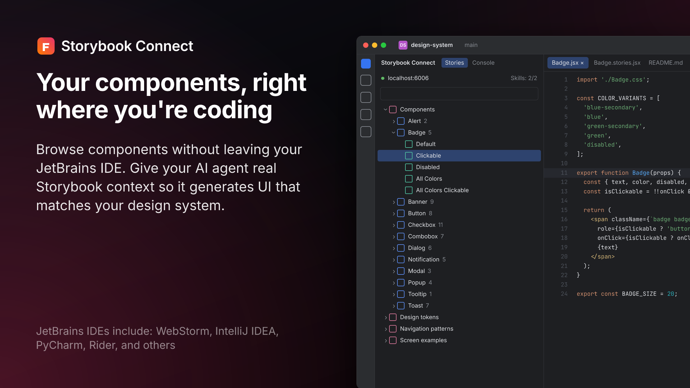
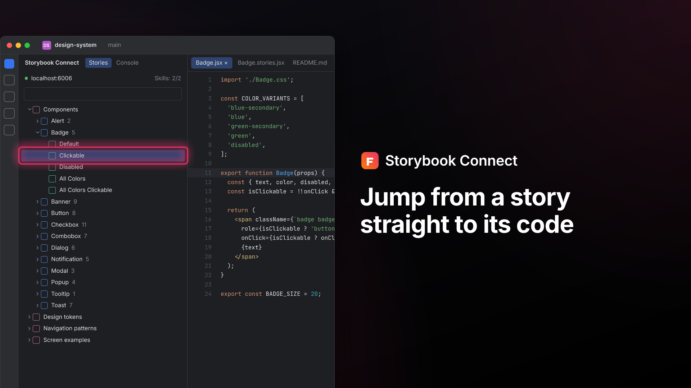
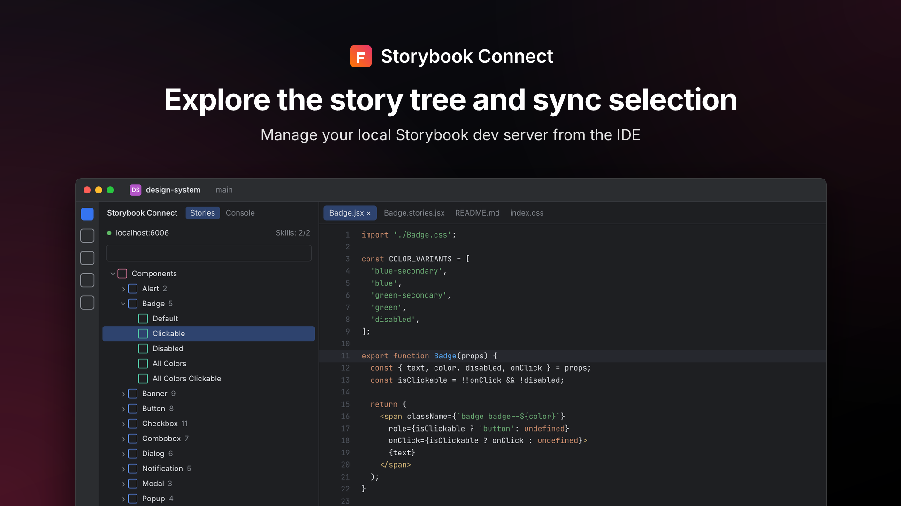
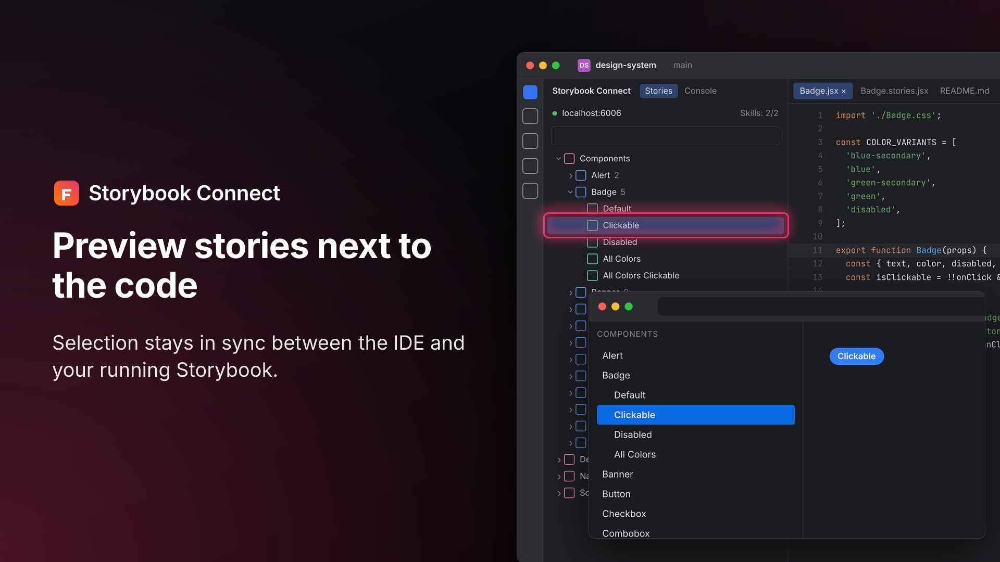

# mpshots

Compose JetBrains Marketplace plugin screenshots from raw IDE captures.

You give it raw 1920×1080 or 2560×1440 screenshots and a short YAML spec. It produces a consistent set of 16:9 slides: brand row, headline, body text and footnotes on a tinted background, with a cropped IDE window that bleeds off the edge of the canvas. It also checks that the IDE text will be legible and that nothing is upscaled.

No browser is needed. Rendering uses [satori](https://github.com/vercel/satori) for layout, [resvg](https://github.com/yisibl/resvg-js) for rasterizing and [sharp](https://sharp.pixelplumbing.com/) for pixels, so it runs anywhere Node 18+ does, including CI.

## Examples

These slides were rendered from [`examples/shots.yaml`](examples/shots.yaml). The source screenshots are mock IDE captures generated by `npm run example`.

| `text-left` | `text-right` with `highlight` |
|---|---|
|  |  |
| **`hero`** | **`text-left` with `overlay`** |
|  |  |

## Install

mpshots is installed straight from this GitHub repository; it isn't on the npm registry. You need Node.js 18.17 or newer and git.

```sh
npm i -g github:jreznot/mpshots#v0.1.0
mpshots --help
```

The `#v0.1.0` tag pins a release; leaving it off installs the latest `main`. To upgrade, run the same command with the new tag.

## Quick start

```sh
mpshots init            # creates shots.yaml and screenshots/
# put raw IDE captures in screenshots/
mpshots grid screenshots/raw-1.png   # writes raw-1.grid.png with pixel coordinates
# edit crop/highlight values in shots.yaml
mpshots build           # → marketplace-screenshots/01-overview.png …, index.html
```

Open `marketplace-screenshots/index.html` to see every slide at about 800px wide, roughly what the Marketplace carousel shows. If IDE text is hard to read there, it will be hard to read on the Marketplace too.

## Commands

| Command | What it does |
|---|---|
| `mpshots init [dir]` | Writes a commented `shots.yaml` and a `screenshots/` folder. |
| `mpshots grid <image> [-o out.png] [--step 100]` | Draws a labelled pixel grid over a raw capture so you can read off `[x, y, w, h]` rectangles. |
| `mpshots validate [spec] [--strict]` | Runs the checks below without rendering. Exits with 1 on errors, or on warnings with `--strict`. |
| `mpshots build [spec] [--only id] [--strict] [-o dir]` | Validates, then renders the PNGs and `index.html`. Refuses to build when there are errors. |

## Layouts

All layout happens on a logical 1920×1080 canvas. `output.width` (1920, 2560 or 3840) sets the pixel size, so every slide always has the same aspect ratio.

| `layout` | Text | Window |
|---|---|---|
| `text-left` (default) | Left column, 100px margin | Right side, bleeds off the right and bottom edges |
| `text-right` | Right column | Left side, bleeds off the left and bottom edges |
| `hero` | Centered brand row, headline and one body line | Wide window below, bleeds off the bottom |
| `window` | None | Large window only |

`align: center` vertically centers the text block. Footnotes stay pinned to the bottom.

Optional extras for any slide:

- **`highlight`**: one or more `[x, y, w, h]` rectangles, in source pixels, drawn as an accent outline with a glow.
- **`overlay`**: a second window, such as a browser preview, floating on top. It is placed in logical canvas pixels with `x`, `y` and `width`.

## How a screenshot is placed

1. `crop` selects the part of the raw capture to show, in source pixels. If omitted, the whole image is used.
2. The crop is scaled to fill the layout's window area. Anything beyond the area bleeds off the canvas, and borders and rounded corners are drawn only on the edges that stay inside. `fit: width` or `fit: height` changes this.
3. Pixels are resampled once, with Lanczos, directly to the final output resolution.

So **the crop decides how big the IDE looks**. A tighter crop means larger UI.

## Checks

| Level | Check |
|---|---|
| error | Screenshot or overlay file missing |
| error | Crop or highlight outside the image |
| error | Duplicate slide ids |
| warn | Source is not 1920×1080, 2560×1440 or 3840×2160 |
| warn | **Upscaled** more than 1.05× (output px per source px). The slide will look soft. |
| warn | **IDE text too small**: `13px × uiScale × zoom` is under 16 logical px |
| warn | Highlight outside the visible part of the window |
| warn | Missing headline, headline over 60 characters, or body text over 240 characters |

### Capture tip: crispness vs. legibility

To pass both checks, the IDE must already be rendering large text when you capture. A 1920×1080 capture at 100% IDE zoom can't be both legible and sharp once composed.

Before capturing, use **View › Appearance › Zoom IDE** (125–150%) or a Retina/HiDPI display. Then set `uiScale` to match: `1.5` for 150%, `2` for Retina. The checks need this value to estimate text size.

Good combinations:

- 2560×1440 at 150% (`uiScale: 1.5`)
- 1920×1080 at 125% (`uiScale: 1.25`)

## Spec reference

```yaml
output:
  width: 1920              # 1920 | 2560 | 3840
  dir: marketplace-screenshots
theme: dark                # dark | light; match the IDE theme you captured
brand:
  name: My Plugin          # shown next to the logo on every slide (override per slide with `brand:`)
  logo: path/to/icon.svg   # optional SVG/PNG
  accent: "#7B61FF"        # background glow + highlight color
fonts:                     # optional, TTF/OTF/WOFF (not WOFF2); default is bundled Inter
  regular: …
  semibold: …
  bold: …
background: path/to/bg.png # optional; replaces the generated gradient glow
defaults:
  uiScale: 1               # IDE zoom at capture time
  footnote: "…"            # default footnote for every slide; `footnote: []` on a slide removes it
slides:
  - id: overview           # file name: 01-overview.png
    layout: text-left
    align: top             # top | center
    headline: …
    body: … | [ …, … ]     # string or list of paragraphs
    footnote: … | [ … ]
    screenshot:
      src: screenshots/raw.png
      crop: [x, y, w, h]
      highlight: [x, y, w, h] | [[…], […]]
      uiScale: 1.5
      fit: fill            # fill | width | height
    overlay:               # optional
      src: …
      crop: [x, y, w, h]
      x: 1100              # logical canvas px
      y: 560
      width: 820
```

## Try the example

```sh
npm install
npm run example   # generates mock captures and builds examples/out/
```

## Marketplace guidelines this follows

- Same aspect ratio for every screenshot
- At least 1200×760
- Legible, relevant content only
- No desktop backgrounds or browser chrome around the IDE

Keeping the default IDE theme in your captures, and keeping personal data out of them, is still up to you.

See [Best practices for listing your plugin](https://plugins.jetbrains.com/docs/marketplace/best-practices-for-listing.html#media).
